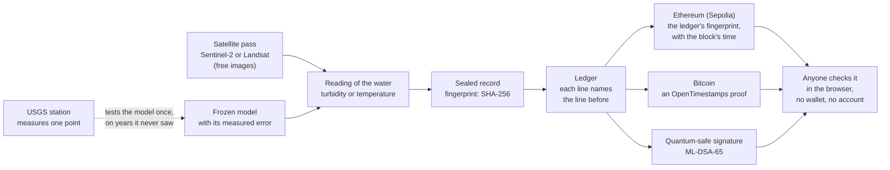
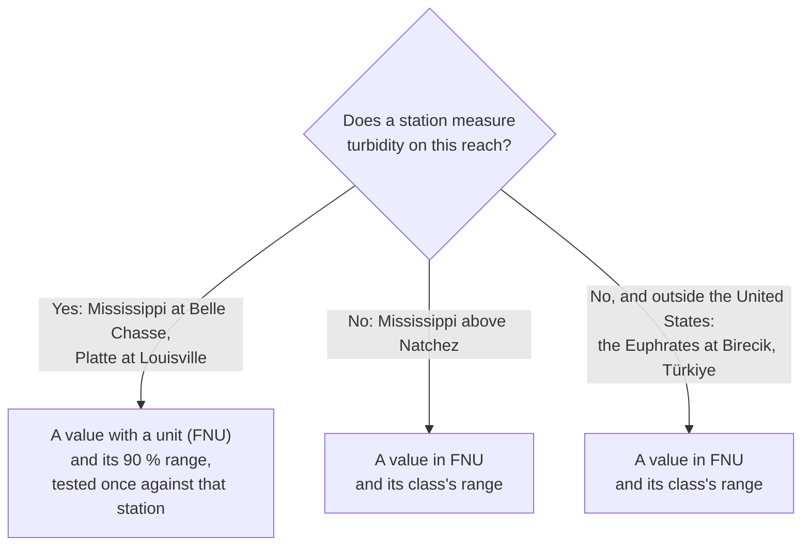
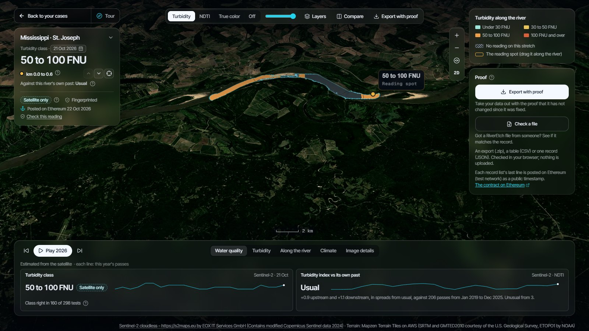

<div align="center">

<h1>RiverEtch</h1>

<p><strong>See the river. Verify the reading.</strong></p>

<p>RiverEtch reads river water from free satellite images, says how far off each reading can be,
and seals every reading so that any later change would show.</p>

[](https://github.com/saulo1112/RiverEtch/actions/workflows/ci.yml)
[](LICENSE)
[](LICENSE-docs)
[](https://sourcify.dev/server/repo-ui/11155111/0xe5d12E7C63041537ffcb3dd258aD69BF345Fe762)

**[Open the live app](https://river-etch.vercel.app)** ·
[Verify a record in one minute](docs/reviewers.md#verify-a-record-in-one-minute) ·
[How it is checked](docs/trust-model.md) · [Results](docs/water-quality/report.md) ·
[Architecture](docs/architecture.md)

</div>


## In one minute

- **The problem.** A measuring station sees one point of a river. Most of the river lies far from
  any station, so when the water turns muddy or warm there, nobody measures it.
- **What RiverEtch does.** Every few days a free satellite (Sentinel-2 or Landsat) passes over the
  river. RiverEtch turns each clear pass into a reading of the water: how muddy it is (turbidity)
  and how warm it is (water temperature).
- **How far off it can be.** Every model was tested once, on years it never saw, against a USGS
  station. The app shows that error beside each reading, and says plainly where the satellite does
  not work.
- **Why you can trust the record.** Each reading gets a fingerprint (a SHA-256 hash). The
  fingerprints are posted on two public blockchains, Ethereum and Bitcoin, and signed with a
  quantum-safe signature. Change one number, and the fingerprint no longer matches.
- **Who it is for.** A water-quality analyst at an environmental agency. The analyst decides;
  RiverEtch informs, with a reading they can cite and show was never changed.

## How it works



1. **Read.** At every clear pass, each water pixel of the river gets a relative index of how muddy
   it is (NDTI). Clouds, glare and the river banks are left out.
2. **Estimate.** At the reading spot, a frozen model turns the pass into a reading with its
   expected range. If the image is outside what the model was trained on, it gives no reading and
   says why.
3. **Seal.** The reading becomes a record, and its fingerprint is added to the river's ledger, a
   list where each line names the fingerprint of the line before.
4. **Witness.** The ledger's last fingerprint is posted on Ethereum, timestamped on Bitcoin and
   signed. Nobody, RiverEtch included, can change those afterwards.
5. **Check.** The web app recomputes all of this in your browser. A job runs the whole cycle twice
   a day (13:00 and 00:00 UTC) on public data only, and holds no key.

The [architecture](docs/architecture.md) shows each part in detail.

## Two kinds of river

The app follows four reaches (stretches of river) on three rivers. On two, a station measures the
water, so RiverEtch can show how close the satellite comes. On the other two, no station measures
turbidity, so the satellite's reading is the only one there is.




_With a station (Mississippi at Belle Chasse): a value, its expected range, and the station's own
measurements beside it._



_With no station (Mississippi above Natchez): a class, and how often that class was right on
rivers the model never saw._

## Every stretch of the river

A station sees one point of a river. So the same frozen model also reads a window every 600 m
along each reach: 38 windows at Belle Chasse, 35 on the Platte, 29 above Natchez and 16 at Birecik.
Each stretch gets a turbidity value in FNU and its class (under 30, 30 to 50, 50 to 100, 100 FNU
and over), or no reading (the record says why). The map paints the river by class, and the **Along the river** tab
shows the year: one column per pass, one row per stretch. Hover a stretch and the map marks it.

**Move the reading spot.** Drag the amber spot along the river, click the river, or use the arrows
in the case file: the panels follow that stretch. On the two reaches with a water-temperature
model, the same windows also get a water-temperature class on each Landsat pass (under 10, 10 to
15, 15 to 20, 20 to 25, 25 to 30, 30 °C and over), fixed before any was read
([preregistration](docs/water-quality/preregistration-along-temperature.md)). The station stays marked where it stands, and its window
shows the value tested against that station, with its 90 % range.

**Earlier years.** The calendar also opens 2019 to 2025. Those years are read again with the same
frozen models, along the river and at the station, and every panel labels them "Recomputed, not
sealed": a pass read after the fact is not a record
([preregistration](docs/water-quality/preregistration-archive.md)). Each earlier pass's own NDTI
map and true-colour image are drawn once, by the same code as 2026's, after their own
[preregistration](docs/water-quality/preregistration-archive-maps.md) is anchored, and published on
the `data` branch only; a pass without them is painted as its classes on the river's 2026 outline.

**The river's daily flow, sealed and checked against its source.** The Climate tab's daily flow
comes from a station (USGS, at Belle Chasse, on the Platte and at Vicksburg for St. Joseph) or, for
the Fırat, from the GloFAS flood model: RiverEtch does not measure it. Every daily run fetches the
whole record again and seals each calendar year that changed, exactly as its source published it,
in the reach's own record list, timestamped on Bitcoin, signed and posted on Ethereum like the
readings ([preregistration](docs/water-quality/preregistration-daily-record.md)). The tab's
**This year's flow** shows the year day by day against the river's usual flow for each day (the
median and the 10th-to-90th percentile range of the record's complete years), with each satellite
pass on its day; it says how unusual a day was, not why. **Check this record** checks the year's
seal and its posts; **Compare with USGS now** fetches the same year from its source in your browser
and says which days it has revised since (provisional values are expected to change). The daily
flow can also be exported with proof, one row per day, and checked with **Check a file**.

- **Fixed before any stretch was read.** The windows, the model and the labels were frozen and
  anchored on Ethereum first ([preregistration](docs/water-quality/preregistration-along-river.md)).
- **Sealed like every record.** Each pass along the river is a record in the reach's own ledger
  (`terrachain:<reach>:along`), anchored, timestamped and signed like the others.
- **A value beside its class's range.** Each stretch shows the model's value in FNU with the range
  of its class ([preregistration](docs/water-quality/preregistration-values.md)). The error of this
  model on rivers it never saw was measured (a median of 37 % over 298 test passes; by station,
  15 % to 162 %; its class matched the station in 160 of those 298 passes), and it is in the
  [report](docs/water-quality/report.md), not on the map.

## Take it out with proof, check it anywhere

Every reading is fingerprinted, posted on Ethereum (test network), timestamped on Bitcoin and
signed. The app makes that useful in two actions, in its **Proof** panel:

- **Export with proof** downloads one zip, built in your browser: the readings as CSV (every row
  with its fingerprint), the sealed records, their record lists, the posts on Ethereum and Bitcoin,
  the signatures, the model sheets and a manifest whose fingerprint you can cite.
- **Check a file** takes a RiverEtch file someone sent you (that zip, a CSV or one record) and
  reports on the whole file in a few seconds, with its progress on the button: how many rows are
  unchanged, on Ethereum, on Bitcoin, or waiting for the next post, which cells changed (with the
  fixed value) and which rows were deleted. It also reads a zip made again from its folder, and the
  records inside it. It trusts nothing inside the file: it reads Ethereum and checks Bitcoin itself.
  Nothing is uploaded.

**Check this reading**, on the reading card, checks the one reading shown and says it in one
sentence ("Same as when it was fixed on 21 Oct 2026. On Ethereum and on Bitcoin."), with its steps
one click away. To watch a check fail, How it works → The fingerprint lets you change one number:


A seal proves that a reading was **not changed**. It does not prove that the reading is **right**:
that comes from the tests below. The [trust model](docs/trust-model.md) lists what each check
catches and what it does not.

## Does it work?

Every error below is out of sample: a locked test (December 2023 to September 2026) that the
training and the model selection never saw, scored once. Each error sits beside its baseline, the
error you would get without the satellite.

| Variable, reach                              | Locked-test error            | Baseline (no satellite)         | Level     |
| -------------------------------------------- | ---------------------------- | ------------------------------- | --------- |
| Turbidity, Mississippi at Belle Chasse (LA)  | **17.8 %** median, 57 passes | 113.7 % (median of past values) | validated |
| Turbidity, Platte at Louisville (NE)         | **20.3 %** median, 54 passes | 66.9 % (median of past values)  | validated |
| Water temperature, Platte at Louisville (NE) | **1.28 °C** mean, 24 passes  | 2.51 °C (day-of-year average)   | estimated |
| Water temperature, Mississippi (LA)          | **0.86 °C** mean, 37 passes  | 1.41 °C (day-of-year average)   | estimated |
| Suspended sediment, both reaches             | too few samples, or biased   | —                               | not shown |
| Discharge, dissolved oxygen (Platte)         | 110.6 % and 1.02 mg/L        | 65.5 % and 1.34 mg/L            | not shown |

- **The two rivers above are the best two of ten stations** (on eight rivers) tested with the same
  protocol. The honest summary is the median over the nine rated: **33.1 %**. Muddy rivers do
  best; clear, tidal rivers do worst. **How it works → Does it work?** lists every one,
  failures included:

  

- **On a river with no station**, the class is tested on rivers the model never saw: it matched the
  station in **160 of 298** passes, against 61 for always guessing the most common class. Half of
  the estimates were off by less than 36.9 % of the station's value, reading low by about 23 %. Four
  classes replaced three (185 of 298) after a preregistered test, decided after seeing the
  three-class result ([report](docs/water-quality/report.md#the-class-tests-2026-10-20-and-21-each-run-once-after-its-anchor)).
- **What did not pass** is reported too: discharge from the water surface erred more than the
  seasonal average; dissolved oxygen missed on its range's coverage; specific conductance did not
  follow the river's changes. The stations' own readings of all three stay visible, labelled as
  measurements.
- **Every result is recomputed in CI** from committed inputs and compared with its MANIFEST, to the
  last printed digit.

### Committed before the station is read

A test is only fair if its answer was not known when it was written. So every test is written,
frozen and anchored on Ethereum before it runs, and then run once: the test on rivers the model
never saw was anchored at block 11952275 and ran 18 minutes later. The same goes for each new
reading: it counts as **prospective** only if its record was sealed and anchored before RiverEtch
read the station.

| Inside the expected range                     | Turbidity, Belle Chasse | Turbidity, Platte | Water temperature, Belle Chasse | Water temperature, Platte |
| --------------------------------------------- | ----------------------- | ----------------- | ------------------------------- | ------------------------- |
| 2026 passes, retrospective                    | 16 of 21                | 8 of 9            | 11 of 13                        | 11 of 13                  |
| Sealed before the station was read (since T0) | 1 of 1                  | 1 of 1            | none yet                        | none yet                  |
| Locked test, retrospective                    | 54 of 57                | 50 of 54          | 33 of 37                        | 23 of 24                  |

The prospective count is as of the 21 Oct 2026 daily run. Two passes say little, and clouds hide
about three passes in four, so it grows slowly. The **Track record** tab shows counts, never
percentages, until there are 20 passes.

## Limits, before you rely on it

- **A seal proves a number was not changed, not that it was right.** The tests above show how often
  it was right.
- **A value with a unit appears only where a station validated the model**, at its window. Along
  the river, and on a river with no station, the reading is a class.
- **Clouds hide about three passes in four** (72–76 % in 2026).
- **The 2026 records sealed before T0 are a backtest:** they were made after their station values
  were public. And sealing first does not prove the station value was unknown: the USGS publishes
  within minutes.
- **Station values are often provisional** and can still be revised; every one is labelled.
- **Sepolia is a test network,** and a proposal would retire it in 2027. The Bitcoin timestamps and
  the signatures do not depend on it.
- **RiverEtch states no trend and blames no one.** The satellite record (since 2018) is far too
  short for a trend, and no output says any event was caused by anything.

## Why it matters for climate

Rivers carry the climate's extremes, and the stations on the two reaches with a station have
recorded both. These are the USGS stations' own daily records, not satellite estimates:

- **Platte at Louisville, Nebraska** (daily record since 1953): in **2019**, the highest annual peak
  in 72 complete years, 6,201 m³/s on 16 March
  ([the March 2019 floods](https://www.usgs.gov/media/images/spring-2019-flooding-louisville-ne));
  in **2023**, the warmest summer day in 20 summers, 32.1 °C.
- **Mississippi at Belle Chasse, Louisiana** (daily record since 2008): **2023, 2022 and 2024** were
  the three lowest 7-day flows in 16 complete years. In 2022 and 2023,
  [saltwater moved up the river](https://www.wwno.org/coastal-desk/2023-09-19/saltwater-threatens-south-louisiana-drinking-water-second-year-in-a-row-amid-severe-drought)
  towards the parish's drinking-water intakes.

Continued warming is projected to make wet and dry extremes more severe
([IPCC AR6 WGI, SPM B.3.1](https://www.ipcc.ch/report/ar6/wg1/chapter/summary-for-policymakers/)).
Those are the years an agency most needs to read a river, between its stations and beyond them.
Each case's **Climate** tab shows its station's whole record, year by year, and **This year's flow**:
the year day by day against the river's usual flow for each day, with the satellite passes marked.
It shows how unusual a day was, not why.

## Quick start

### Requirements

| Tool                                                          | Version                                | Needed for                                    |
| ------------------------------------------------------------- | -------------------------------------- | --------------------------------------------- |
| [Git](https://git-scm.com/)                                   | any recent                             | everything                                    |
| [Node.js](https://nodejs.org/)                                | 24 LTS (see `.nvmrc`; npm 11 included) | the web app, the contracts, the Git hooks     |
| [uv](https://docs.astral.sh/uv/getting-started/installation/) | 0.12 or newer                          | the Python pipeline (uv installs Python 3.12) |

### Run the web app

```bash
git clone https://github.com/saulo1112/RiverEtch.git
cd RiverEtch
nvm use            # or any other way to run Node 24
npm install        # installs every workspace and the Git pre-commit hook
npm run dev        # http://localhost:5173
```

The app needs no account and no wallet. `web/.env.example` lists the optional WalletConnect and
Sepolia settings.

### Reproduce the results

```bash
cd pipeline
uv sync                                                  # Python 3.12 and the locked dependencies
uv run climate-pipeline quality run --root ..            # recompute every validation from the snapshots
uv run climate-pipeline quality verify --root ..         # compare them with the MANIFEST, to the last digit
uv run pytest tests/test_reach_examples.py               # check every committed record's seal, ledger and card
uv run climate-pipeline ledger verify --root ..          # the frozen rules, cards and MANIFEST are unchanged
```

`reach run` makes new records from public data, `reach check` compares them with the stations, and
`reach score` scores the anchored claims under the frozen rule. See
[the reach pipeline](docs/water-quality/reach/README.md).

### Run every check

```bash
npm run check            # format, lint, compile, types, all tests, web build
npm run pipeline:check   # ruff format and lint, mypy --strict, pytest
```

The contract is in `contracts/`: `npm run compile` builds it and `npm test` runs its tests.
Anchoring on Sepolia is described in [anchoring](docs/anchoring.md); keys are read from Hardhat's
encrypted keystore, never from committed files.

## What is in this repository

```text
.
├── pipeline/   Python 3.12 (uv): the satellite readings, the tests (`quality`), the records (`reach`)
├── web/        Vite + React: the globe, the cases and each case's map, charts and record checks
├── contracts/  Hardhat 3: the ledger anchor (LedgerAnchor, on Sepolia)
├── docs/       results, preregistrations, records, ledgers, the trust model and the decision log
└── .github/    CI, and the daily run that makes the new records
```

| If you want…                     | Read                                                         |
| -------------------------------- | ------------------------------------------------------------ |
| the short path for a reviewer    | [docs/reviewers.md](docs/reviewers.md)                       |
| what is checked, and what is not | [docs/trust-model.md](docs/trust-model.md)                   |
| every result, failures included  | [docs/water-quality/report.md](docs/water-quality/report.md) |
| how the system fits together     | [docs/architecture.md](docs/architecture.md)                 |
| the record format                | [docs/schema/README.md](docs/schema/README.md)               |
| why each choice was made         | [docs/decisions.md](docs/decisions.md)                       |
| every document                   | [docs/README.md](docs/README.md)                             |

## Frequently asked questions

- **Is this a forecast?** No. Every reading is of a pass that already happened.
- **Do I need a wallet or an account?** No. Reading and checking a record needs neither; a wallet
  only lets you read Ethereum through your own connection.
- **Why a blockchain?** A seal needs a date that RiverEtch itself cannot move. A public chain gives
  one that no single party sets and nobody can edit
  ([why a blockchain, and why two](docs/trust-model.md#why-a-blockchain-and-why-two)).
- **Why only a class where there is no station?** Because nothing there can check a number. The
  class comes with the error measured on rivers the model never saw.
- **Can I get the data?** Yes. The **Export** menu gives the series (CSV), the reach's geometry
  (GeoJSON), its ledger (JSONL) and its model card (JSON).

## Glossary

| Term            | Meaning                                                                                         |
| --------------- | ----------------------------------------------------------------------------------------------- |
| Turbidity       | How muddy the water is                                                                          |
| FNU             | Formazin Nephelometric Units, the unit the USGS turbidity sensors report                        |
| NDTI            | Normalized Difference Turbidity Index, (red − green) / (red + green): relative, with no unit    |
| Median error    | MdSA, median symmetric accuracy: 100 × (exp(median of abs(ln(estimate / station))) − 1), in %   |
| Locked test     | Years held out from training and selection, scored once                                         |
| Preregistration | The rules of a test, written and committed before any result is computed                        |
| Level           | _validated_ / _estimated_ / _indicative_: what a locked test earned; below _estimated_, no unit |
| Model card      | The frozen model of a reach and a target, with its test scores; records name its SHA-256        |
| Seal, ledger    | A record's SHA-256, and the append-only list of seals where each line names the one before      |
| Anchor          | A ledger's last fingerprint stored on Ethereum with the block's time                            |
| T0              | The block time of the scoring rule's first anchor: passes after it can be prospective           |

## Contributing

Conventions (commit messages, branches, documentation standards) are in
[CONTRIBUTING.md](CONTRIBUTING.md). Questions and problems go to the
[issue tracker](https://github.com/saulo1112/RiverEtch/issues).

## License

The code is under the [MIT License](LICENSE); the documentation and the data RiverEtch produces
(`docs/`) are under [CC BY 4.0](LICENSE-docs). Third-party data keep their own terms: USGS and
Landsat data are public domain; Sentinel-2 data follow the Copernicus data policy.

## Contact

Maintained by [@saulo1112](https://github.com/saulo1112).
