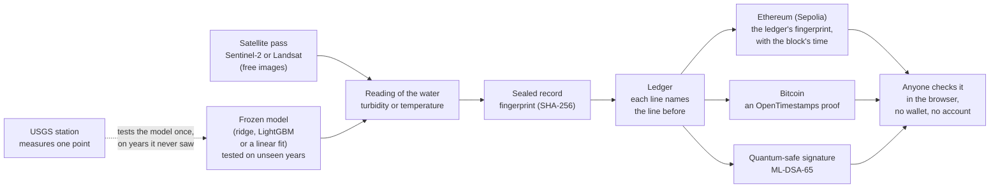
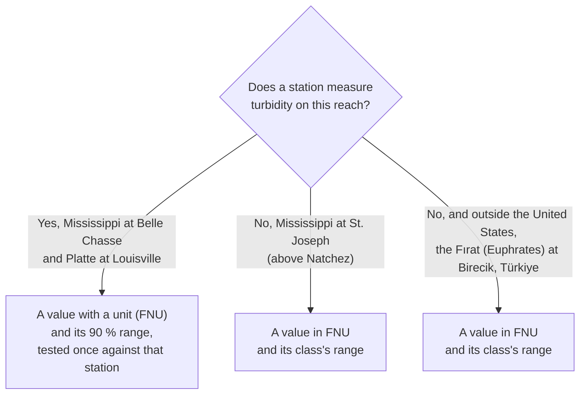

<div align="center">

<h1>RiverEtch</h1>

<p><strong>See the river. Verify the reading.</strong></p>

<p>A river changes between the places it is sampled, and can run for kilometres unmeasured.
RiverEtch reads the water from free satellite images, gives each reading a number with the range to
expect, and seals every reading so that any later change would show.</p>

<p><sub>Built for the <a href="https://ieee-climatechain-hack.devpost.com/">IEEE ClimateChain Global Hackathon</a> 2026
· Track 4: Climate Data &amp; Environmental Monitoring</sub></p>

[](https://github.com/saulo1112/RiverEtch/actions/workflows/ci.yml)
[](LICENSE)
[](LICENSE-docs)
[](https://sourcify.dev/server/repo-ui/11155111/0xe5d12E7C63041537ffcb3dd258aD69BF345Fe762)

**[Open the live app](https://river-etch.vercel.app)** ·
[Verify a record in one minute](docs/reviewers.md#check-a-reading-in-one-minute) ·
[How it is checked](docs/trust-model.md) · [Results](docs/water-quality/report.md) ·
[Architecture](docs/architecture.md)
[Demo Video](https://youtu.be/7XM9NeKMYoY)

</div>


## The problem

When a river floods, or runs so low that salt water creeps up it, the people who have to decide (a
water utility, an environmental agency) need to know what the water is like, how muddy or how warm.
A measuring station answers that for the one spot where it stands. The rest of the river, and the
many rivers with no station at all, go unmeasured exactly when it matters.

Satellites look at those rivers every few days, for free. But a number made from a picture raises
two fair questions. How far off can it be? And could someone change it later? RiverEtch is built to
answer both, so that a reading can be cited and not only looked at.

## What RiverEtch does about it

- **It reads the river, not one point of it:** every clear pass of a free satellite (Sentinel-2 or
  Landsat) becomes a reading of how muddy the water is (turbidity, in FNU) and how warm it is (°C),
  at the station and on a window every 600 m along the reach.
- **It gives a number, with the range to expect:** turbidity is a value in FNU at the station and
  on every stretch along the river, and water temperature is a value in °C at the station and a
  5 °C band along the river. Each value comes from a frozen model tested once, on years it never saw, against USGS stations, with every result published river by river in the
  [report](docs/water-quality/report.md). Where a station exists, the value comes with its expected
  range, a 90 % range that the locked test then checked. Where none does, it
  comes with the range of its class (under 30, 30 to 50, 50 to 100, 100 FNU and over).
- **It makes a quiet edit impossible:** each reading gets a fingerprint (a SHA-256 hash). The
  fingerprints are posted on two public blockchains, Ethereum and Bitcoin, and signed with a
  quantum-safe signature. Change one number and the fingerprint no longer matches. Anyone can check
  it in their browser, with no wallet and no account.
- **Who it is for:** people who have to answer for a river, such as water utilities, environmental
  and water agencies, river basin authorities, and the researchers and journalists who check their
  numbers. A utility can see how muddy the water is upstream of its intake before it arrives, an
  agency can follow a stretch with no station during a flood or a drought, and a basin authority can
  share one record that every party can verify. They decide, and RiverEtch informs them with a
  reading they can cite and show was never changed.

## Built for the IEEE ClimateChain Hackathon

RiverEtch is the entry for Track 4, Climate Data & Environmental Monitoring. The first table shows
how it meets what the track asks for, and the second where to look for each of the hackathon's
criteria.

| The track asks for                                    | RiverEtch                                                                                |
| ----------------------------------------------------- | ---------------------------------------------------------------------------------------- |
| Satellite data integration for environmental tracking | Sentinel-2 and Landsat passes become turbidity and water temperature, stretch by stretch |
| Climate data collection and verification              | Each reading is sealed, then witnessed on Ethereum, on Bitcoin and by a signature        |
| Transparent climate data sharing                      | Export with proof and Check a file let the data leave with the means to verify it        |

| Criterion                                | Where to look                                                                                                                       |
| ---------------------------------------- | ----------------------------------------------------------------------------------------------------------------------------------- |
| Climate impact and environmental benefit | [Why it matters for climate](#why-it-matters-for-climate) and the [results](docs/water-quality/report.md)                           |
| Technical innovation and blockchain use  | [Architecture](docs/architecture.md) and [why a blockchain, and why two](docs/trust-model.md#why-a-blockchain-and-why-two)          |
| Feasibility and implementation quality   | The CI badge above, the [daily run](docs/architecture.md) on a free runner, and the [quick start](#quick-start)                     |
| Data security and transparency           | The [trust model](docs/trust-model.md), with what each check catches and what it does not                                           |
| User experience and design               | The [live app](https://river-etch.vercel.app), and [one minute to verify a record](docs/reviewers.md#check-a-reading-in-one-minute) |
| Scalability and sustainability           | A new reach is a site file and a settings entry, and imagery and CI are free ([reach pipeline](docs/water-quality/reach/README.md)) |

## How it works



1. **Read:** at every clear pass, each water pixel of the river gets a relative index of how muddy
   it is (NDTI). Clouds, glare and the river banks are left out.
2. **Estimate:** a frozen model turns the pass into a value. At a station it is a value in FNU (or
   °C) with its expected range, and on a reach with no station and on every stretch it is a
   turbidity value with the range of its class (water temperature along the river is a 5 °C band).
   If the image is outside what the model was trained on, it gives no reading and says why.
3. **Seal:** the reading becomes a record, and its fingerprint is added to the river's ledger, a
   list where each line names the fingerprint of the line before.
4. **Witness:** the ledger's last fingerprint is posted on Ethereum, timestamped on Bitcoin and
   signed. Nobody, RiverEtch included, can change those afterwards.
5. **Check:** the web app recomputes all of this in your browser. A job reads, seals and
   timestamps the new passes twice a day (13:00 and 00:00 UTC) on public data only, and holds no
   key. The owner then signs the new ledger heads and posts them on Ethereum.

The [architecture](docs/architecture.md) shows each part in detail.

### The models

Each value comes from a small, frozen model (machine learning for turbidity, a calibration for
water temperature), chosen on the training years and then scored once on years it never saw.

- **Turbidity at a station:** a ridge regression on the logarithm of Sentinel-2's visible,
  red-edge and near-infrared reflectances and band ratios (such as near-infrared over red),
  pretrained on other US rivers' station pairs and then adjusted to the station's own pairs. It was
  chosen among candidates that included a one-ratio log-log fit and a LightGBM model.
- **Turbidity where there is no station, and along the river:** a LightGBM model (gradient-boosted
  trees) trained on the station pairs of all nine river groups, with no adjustment to any one
  station. Its error on a new river comes from a test that held out each group in turn.
- **Water temperature:** Landsat 8/9's surface temperature (Collection 2, thermal band 10), taken
  as the median of the clear-water pixels at the station. On the Platte it is used as it is, and on
  the Mississippi with a linear correction fitted against the station at Baton Rouge.
- **The expected range:** split conformal prediction. Leave-one-year-out errors in the training
  years set a 90 % range, and the locked test then checked it (54 of 57 passes inside at Belle
  Chasse, 50 of 54 on the Platte).

Each model is a JSON card under [`docs/water-quality/results/models/`](docs/water-quality/results/models/),
with its features, coefficients and test scores, and its SHA-256 is part of every record it makes.

## Two kinds of river

The app follows four reaches (stretches of river) on three rivers. On two, a station measures the
water, so RiverEtch can show how close the satellite comes. On the other two, no station measures
turbidity, so the satellite's reading is the only one there is.




_With a station (Mississippi at Belle Chasse), a value, its expected range, and the station's own
measurements beside it._


_With no station (Mississippi at St. Joseph), a value, the range of its class, and how often that
class was right on rivers the model never saw. Point at any stretch of the river and it gives its
own value._

## Every stretch of the river

A station sees one point of a river. So the same frozen model also reads a window every 600 m
along each reach, 38 windows at Belle Chasse, 35 on the Platte, 29 at St. Joseph and 16 at Birecik.
Each stretch gets a turbidity value in FNU and its class (under 30, 30 to 50, 50 to 100, 100 FNU
and over), or no reading, and then the record says why (for example, where the river is wider than
any river the model was trained on). The map paints the river by class, and the Along the river tab
shows the year with one column per pass and one row per stretch. Hover a stretch and the map marks
it and shows its value.


- **Fixed before any stretch was read:** the windows, the model and the labels were frozen and
  anchored on Ethereum first ([preregistration](docs/water-quality/preregistration-along-river.md)).
- **Sealed like every record:** each pass along the river is a record in the reach's own ledger
  (for example `terrachain:mississippi-belle-chasse:along`), anchored, timestamped and signed like
  the others. The labels start with `terrachain` because the project was first called TerraChain,
  and the first anchors on Ethereum were made under those names. Renaming them would cut the link
  between those anchors and their records, so every label keeps the old prefix
  ([why](docs/trust-model.md#why-the-labels-read-terrachain)).
- **A value on every stretch:** each stretch shows the model's value in FNU with the range of its
  class ([preregistration](docs/water-quality/preregistration-values.md)). The same model was tested
  on rivers it never saw. In half of 298 passes its value was within 36.9 % of the station's, and
  its class matched the station in 160 of them ([report](docs/water-quality/report.md)).

To read another stretch, drag the orange reading spot along the river, click the river, or use the
arrows in the case file, and the panels follow that stretch. The station stays marked where it
stands, and its window shows the value tested against that station, with its 90 % range.

### Water temperature, a value at the station and a band along the river

Water temperature comes from Landsat 8 and 9, not Sentinel-2, so it appears only on the days a
Landsat satellite passed over a clear river. Together they pass about every 8 days, while Sentinel-2
passes about every 5. On those days the reading depends on where you look.

- **At the station:** a value in °C with its 90 % range (±2.8 °C on the Platte, ±1.8 °C on the
  Mississippi), because that is where the model was tested, pass by pass, against a station's
  thermometer (for the Mississippi, the one at Baton Rouge).
- **Along the river:** the same model reads every 600 m window, and the app shows its 5 °C band
  (under 10, 10 to 15, 15 to 20, 20 to 25, 25 to 30, 30 °C and over). Turbidity can show a value on
  every stretch because its model was also tested on rivers it never saw, and water temperature has
  no such test. Landsat's thermal band is also measured at 100 m and delivered on 30 m pixels, so on
  a narrow river a pixel can mix in heat from the banks. The band says what the reading supports,
  and it was fixed before any window was read
  ([preregistration](docs/water-quality/preregistration-along-temperature.md)).

### Earlier years, 2019 to 2025

The calendar also opens the seven years before 2026, so you can see how the river behaved through
the Platte's 2019 flood or the Mississippi's low water of 2022 to 2024. Every pass of those years is
read with the same frozen models, along the river and at the station, and the map shows that pass's
own satellite image where one was drawn. These years carry the label "Recomputed, not sealed", and the difference
matters.

- **2026 is the record:** every 2026 pass is a sealed record in the river's record list, the list
  that is fingerprinted, posted on Ethereum and timestamped on Bitcoin. Since the first daily run, on
  20 October 2026, each new pass is sealed the same day the daily run reads it, so the record keeps growing pass by pass.
  The passes from January to mid-October were sealed in October, after their station values were
  public, and the Track record tab counts them apart.
- **2019 to 2025 are context:** they were read again in October 2026, years after the fact, to show
  how the river behaved before the record began. A fingerprint made today would only prove that the
  number exists today, so these passes stay out of the record lists, and so out of Export with proof
  and the counts. You can still check them. The images are public, the models are frozen, and the
  year's file (one download in the Proof panel) names the code and the models, so anyone can read
  the same passes again and get the same numbers.

Beside the label, the panel says what each pass was to the model. Training years (until November 2023) are passes the model learned from, so they fit better than a new pass would. Locked test
passes (from December 2023) are passes the model never saw. On the two reaches with no station, the
panel says the model never saw them (St. Joseph is a reach it never saw, and it learned from two
other Mississippi stations). The label and these phases were fixed before
the earlier years were read ([preregistration](docs/water-quality/preregistration-archive.md)).

## Take it out with proof, check it anywhere

Every reading is fingerprinted, posted on Ethereum (test network), timestamped on Bitcoin and
signed. The app makes that useful in two actions, in its Proof panel.

- **Export with proof:** downloads one zip, built in your browser, with the readings as CSV (every
  row with its fingerprint), the sealed records, their record lists, the posts on Ethereum and
  Bitcoin, the signatures, the model sheets and a manifest whose fingerprint you can cite.
- **Check a file:** takes a RiverEtch file someone sent you (that zip, a CSV or one record) and
  reports on the whole file in a few seconds, with its progress on the button. It says how many rows
  are unchanged, on Ethereum, on Bitcoin, or waiting for the next post, which cells changed (with
  the fixed value) and which rows were deleted. It also reads a zip made again from its folder, and
  the records inside it. It trusts nothing inside the file, because it reads Ethereum and checks
  Bitcoin itself, and nothing is uploaded.

Check this reading, on the reading card, checks the one reading shown and says it in one sentence
("Same as when it was fixed on 21 Oct 2026. On Ethereum and on Bitcoin."), with its steps one click
away. To watch a check fail, open How it works and then The fingerprint, where you can change one
number.


A seal proves that a reading was not changed, and how close it is comes from the tests below. The
[trust model](docs/trust-model.md) lists what each check catches.

## Does it work?

Every error below is out of sample, from a locked test (December 2023 to September 2026, and to
November 2025 for the Mississippi's water temperature) that the training and the model selection
never saw, scored once. Each error sits beside its baseline, the
error you would get without the satellite.

| Variable, reach                                     | Locked-test error                | Baseline (no satellite)         | Level     |
| --------------------------------------------------- | -------------------------------- | ------------------------------- | --------- |
| Turbidity, Mississippi at Belle Chasse (LA)         | 17.8 % median, 57 passes         | 113.7 % (median of past values) | validated |
| Turbidity, Platte at Louisville (NE)                | 20.3 % median, 54 passes         | 66.9 % (median of past values)  | validated |
| Water temperature, Platte at Louisville (NE)        | 1.28 °C mean absolute, 24 passes | 2.51 °C (day-of-year average)   | estimated |
| Water temperature, Mississippi at Belle Chasse (LA) | 0.86 °C mean absolute, 37 passes | 1.41 °C (day-of-year average)   | estimated |

- **Across the nine rated stations:** tested with the same protocol, the median error is 33.1 %,
  against 71.4 % for guessing the river's usual value (at the middle station, the Mississippi at
  Cape Girardeau). It works best on sediment-carrying rivers, the ones floods fill with mud. The
  chapter Does it work? in How it works shows every station.

  

- **On rivers the model never saw:** in half of 298 passes its value was within 36.9 % of the
  station's, and its class matched the station in 160 of 298, against 61 for always guessing the
  most common class ([report](docs/water-quality/report.md#the-class-tests-2026-10-20-and-21-each-run-once-after-its-anchor)).
- **Shown only where the test supports it:** discharge, dissolved oxygen, specific conductance and
  suspended sediment were tested the same way and are not shown as satellite readings, and the app
  shows the stations' own values for them instead.
- **Every result is recomputed in CI:** from committed inputs, and compared with its MANIFEST to the
  last printed digit.

### Committed before the station is read

A test is only fair if its answer was not known when it was written. So every test is written,
frozen and anchored on Ethereum before it runs, and then run once. The test on rivers the model
never saw was anchored at block 11952275 and ran 18 minutes later. The same goes for each new
reading, which counts as prospective only if its record was sealed and anchored before RiverEtch
read the station.

| Inside the expected range                     | Turbidity, Belle Chasse | Turbidity, Platte | Water temperature, Belle Chasse | Water temperature, Platte |
| --------------------------------------------- | ----------------------- | ----------------- | ------------------------------- | ------------------------- |
| 2026 passes, retrospective                    | 16 of 21                | 8 of 9            | 11 of 13                        | 11 of 13                  |
| Sealed before the station was read (since T0) | 2 of 2                  | 1 of 1            | none yet                        | none yet                  |
| Locked test, retrospective                    | 54 of 57                | 50 of 54          | 33 of 37                        | 23 of 24                  |

The prospective count is as of the 24 Oct 2026 daily run, and grows with every clear pass. The
Track record tab shows counts, not percentages, until there are 20 passes.

## Good to know

- A seal shows that a reading was not changed, and the tests above show how close it is.
- Clouds hide some passes (about three in four in 2026), and a cloudy pass simply has no reading.
- Station values are often provisional and can still be revised, and every one is labelled.
- The Ethereum posts are on Sepolia, a test network. The Bitcoin timestamps and the signatures do
  not depend on it.

## Why it matters for climate

Rivers carry the climate's extremes, and the stations on the two reaches with a station have
recorded both. These are the USGS stations' own daily records, not satellite estimates.

- **Platte at Louisville, Nebraska (daily record since 1953):** in 2019, the highest annual peak in
  72 complete years, 6,201 m³/s on 16 March
  ([the March 2019 floods](https://www.usgs.gov/media/images/spring-2019-flooding-louisville-ne)),
  and in 2023, the warmest summer day of the 20 summers to 2025, 32.1 °C.
- **Mississippi at Belle Chasse, Louisiana (daily record since 2008):** 2023, 2022 and 2024 were
  the three lowest 7-day flows in 16 complete years. In 2022 and 2023,
  [saltwater moved up the river](https://www.wwno.org/coastal-desk/2023-09-19/saltwater-threatens-south-louisiana-drinking-water-second-year-in-a-row-amid-severe-drought)
  towards the parish's drinking-water intakes.

Continued warming is projected to make wet and dry extremes more severe
([IPCC AR6 WGI, SPM B.3.1](https://www.ipcc.ch/report/ar6/wg1/chapter/summary-for-policymakers/)).
Those are the years an agency most needs to read a river, between its stations and beyond them.

### The river's daily flow

How much water a river carries (its flow, or discharge, in m³/s) tells you whether a day is a flood,
a drought or an ordinary day, so each case's Climate tab shows it beside the satellite readings.
RiverEtch does not measure the flow. It takes it from a source and keeps that source's own numbers.

- **Where it comes from:** at Belle Chasse and on the Platte, the USGS station on the reach. For
  St. Joseph, the nearest USGS station that publishes daily flow, at Vicksburg. For the Fırat, where
  no open daily record of the river was found, GloFAS, the global flood model of the EU's Copernicus
  Emergency Management Service, which computes the flow of large rivers worldwide from weather
  data and a model of the land.
  The tab labels GloFAS's numbers as modelled, not measured.
- **Sealed like the readings:** every daily run fetches the whole record again and seals each
  calendar year that changed, exactly as the source published it, in the reach's own record list,
  timestamped on Bitcoin, signed and posted on Ethereum
  ([preregistration](docs/water-quality/preregistration-daily-record.md)). Check this record checks
  a year's seal and its posts, and Compare with USGS now fetches the same year from USGS in your
  browser and says which days USGS has revised since (provisional values are expected to change).
  The daily flow can also be exported with proof, one row per day, and checked with Check a file.
- **This year's flow:** a chart of the year shown, day by day, against the river's usual flow for
  each day of the year. The usual flow is the median of the 7 days around that day in every complete
  year of the record up to 2025, and the shaded band around it is where 8 in 10 of those values fell
  (the 10th to 90th percentiles). Each satellite pass is marked on its day, so you can see whether a
  reading was taken in a flood, a drought or an ordinary week. The chart says how unusual a day
  was, never why.

## Quick start

### Requirements

| Tool                                                          | Version                                | Needed for                                    |
| ------------------------------------------------------------- | -------------------------------------- | --------------------------------------------- |
| [Git](https://git-scm.com/)                                   | any recent                             | everything                                    |
| [Node.js](https://nodejs.org/)                                | 24 LTS (see `.nvmrc`; npm 11 included) | the web app, the contracts, the Git hooks     |
| [uv](https://docs.astral.sh/uv/getting-started/installation/) | 0.12 or newer                          | the Python pipeline (uv installs Python 3.12) |

### Run the web app

```bash
git clone https://github.com/saulo1112/RiverEtch.git
cd RiverEtch
nvm use            # or any other way to run Node 24
npm install        # installs every workspace and the Git pre-commit hook
npm run dev        # http://localhost:5173
```

The app needs no account and no wallet. `web/.env.example` lists the optional WalletConnect and
Sepolia settings.

### Reproduce the results

```bash
cd pipeline
uv sync                                                  # Python 3.12 and the locked dependencies
uv run climate-pipeline quality run --root ..            # recompute every validation from the snapshots
uv run climate-pipeline quality verify --root ..         # compare them with the MANIFEST, to the last digit
uv run pytest tests/test_reach_examples.py               # check every committed record's seal, ledger and card
uv run climate-pipeline ledger verify --root ..          # the frozen rules, cards and MANIFEST are unchanged
```

`reach run` makes new records from public data, `reach check` compares them with the stations, and
`reach score` scores the anchored claims under the frozen rule. See
[the reach pipeline](docs/water-quality/reach/README.md).

### Run every check

```bash
npm run check            # format, lint, compile, types, all tests, web build
npm run pipeline:check   # ruff format and lint, mypy --strict, pytest
```

The contract is in `contracts/`. `npm run compile` builds it and `npm test` runs its tests.
Anchoring on Sepolia is described in [anchoring](docs/anchoring.md), and keys are read from
Hardhat's encrypted keystore, never from committed files.

## What is in this repository

```text
.
├── pipeline/   Python 3.12 (uv): the satellite readings, the tests (`quality`), the records (`reach`)
├── web/        Vite + React: the globe, the cases and each case's map, charts and record checks
├── contracts/  Hardhat 3: the ledger anchor (LedgerAnchor, on Sepolia)
├── docs/       results, preregistrations, records, ledgers, the trust model and the decision log
└── .github/    CI, and the daily run that makes the new records
```

| If you want…                     | Read                                                         |
| -------------------------------- | ------------------------------------------------------------ |
| the short path for a reviewer    | [docs/reviewers.md](docs/reviewers.md)                       |
| what is checked, and what is not | [docs/trust-model.md](docs/trust-model.md)                   |
| every result, river by river     | [docs/water-quality/report.md](docs/water-quality/report.md) |
| how the system fits together     | [docs/architecture.md](docs/architecture.md)                 |
| the record format                | [docs/schema/README.md](docs/schema/README.md)               |
| why each choice was made         | [docs/decisions.md](docs/decisions.md)                       |
| every document                   | [docs/README.md](docs/README.md)                             |

## Frequently asked questions

- **Is this a forecast?** No. Every reading is of a pass that already happened.
- **Do I need a wallet or an account?** No. Reading and checking a record needs neither, and a
  wallet only lets you read Ethereum through your own connection.
- **Why a blockchain?** A seal needs a date that RiverEtch itself cannot move. A public chain gives
  one that no single party sets and nobody can edit
  ([why a blockchain, and why two](docs/trust-model.md#why-a-blockchain-and-why-two)).
- **How good is a number where there is no station?** Nothing there can check it, so its error was
  measured on rivers the model never saw. In half of 298 passes its value was within 36.9 % of the
  station's (from 15 % at Belle Chasse to 162 % on the Platte, reading low by about 23 %), and its
  class matched the station in 160 of them. The map shows the value with its
  class's range, and the full test, river by river, is in the [report](docs/water-quality/report.md).
- **Can I get the data?** Yes. Export with proof gives one zip with the readings (CSV), the
  reach's shape (GeoJSON), the sealed records, their ledgers (JSONL) and the model sheets (JSON).

## Glossary

| Term            | Meaning                                                                                       |
| --------------- | --------------------------------------------------------------------------------------------- |
| Turbidity       | How muddy the water is                                                                        |
| FNU             | Formazin Nephelometric Units, the unit the USGS turbidity sensors report                      |
| NDTI            | Normalized Difference Turbidity Index, (red − green) / (red + green), relative, with no unit  |
| Median error    | MdSA, median symmetric accuracy, 100 × (exp(median of abs(ln(estimate / station))) − 1), in % |
| Locked test     | Years held out from training and selection, scored once                                       |
| Preregistration | The rules of a test, written and committed before any result is computed                      |
| Level           | _validated_, _estimated_ or _indicative_, what a station's locked test earned                 |
| Model card      | The frozen model of a reach and a target, with its test scores, and records name its SHA-256  |
| Seal, ledger    | A record's SHA-256, and the append-only list of seals where each line names the one before    |
| Anchor          | A ledger's last fingerprint stored on Ethereum with the block's time                          |
| GloFAS          | Global Flood Awareness System, the Copernicus model of river flow worldwide                   |
| T0              | The block time of the scoring rule's first anchor, after which passes can be prospective      |

## Contributing

Conventions (commit messages, branches, documentation standards) are in
[CONTRIBUTING.md](CONTRIBUTING.md). Questions and problems go to the
[issue tracker](https://github.com/saulo1112/RiverEtch/issues).

## License

The code is under the [MIT License](LICENSE), and the documentation and the data RiverEtch produces
(`docs/`) are under [CC BY 4.0](LICENSE-docs). Third-party data keep their own terms. USGS and
Landsat data are public domain, and Sentinel-2 data follow the Copernicus data policy.

## Contact

Maintained by [@saulo1112](https://github.com/saulo1112).
