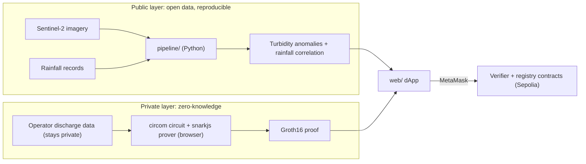

# Climate Change IEEE

Mining and heavy rainfall can both turn a Colombian river brown, but they mean very different
things. This project watches rivers from space: it uses free Sentinel-2 satellite imagery to detect
unusual turbidity (sediment-laden, cloudy water) and checks every anomaly against rainfall records,
to tell storm runoff apart from other likely causes such as mining discharges. Mining operations,
in turn, can prove on the Ethereum blockchain that their discharges stayed within their
environmental permit, using a zero-knowledge proof: anyone can verify that the permit was
respected, while the company's confidential operational data is never revealed.

Built for the IEEE ClimateChain Global Hackathon (October 5–25, 2026).

## Status

**Hackathon work in progress. As of 2026-10-05, this repository contains scaffolding only:**
tooling, CI, a toolchain-demo circuit, a placeholder contract and a placeholder UI. No project
feature is implemented yet. "Climate Change IEEE" is a working title.

## Architecture overview

The system has two layers with deliberately different properties. Separating them is the core
design decision of the project.

|                         | Public satellite-detection layer                                      | Private ZK-compliance layer                                  |
| ----------------------- | --------------------------------------------------------------------- | ------------------------------------------------------------ |
| **Question it answers** | Did the river's turbidity behave abnormally, and did it rain heavily? | Did this operator stay within its discharge permit?          |
| **Inputs**              | Open data: Sentinel-2 imagery, rainfall records                       | Confidential: the operator's own discharge measurements      |
| **Who computes**        | Anyone (open code + open data)                                        | The operator, in their own browser                           |
| **What is published**   | Anomaly events and the evidence behind them                           | Only a proof and a commitment, never the measurements        |
| **Why it is trusted**   | Reproducibility: anyone can re-run the pipeline                       | Cryptography: a Groth16 proof checked by a Solidity verifier |

**Public layer: transparency.** The Python pipeline (`pipeline/`) pulls Sentinel-2 imagery
through Sentinel Hub (Copernicus Data Space Ecosystem), estimates turbidity for river reaches,
flags anomalies against each reach's normal behaviour, and correlates them with extreme-rainfall
events. Nothing is secret, so the results are credible because anyone can reproduce them.

**Private layer: confidentiality with verifiability.** Operating data of a mine is commercially
sensitive, so asking companies to publish it does not work. Instead, the operator proves a
statement about that data with a zero-knowledge circuit (`contracts/circuits/`), for example
"every discharge reading in this period was below my permit limit". The proof is generated in the
browser and verified on-chain (Sepolia) by a contract generated from the circuit; only the result
and a commitment to the data become public.

**How they meet.** Both layers are indexed by place and time. An anomaly downstream of a site can be
compared with that site's compliance proof for the same period and with the rainfall record: a
spike during a storm with a valid compliance proof reads very differently from a spike in dry
weather with no proof.

**Trust boundary.** A zero-knowledge proof shows that the operator's data satisfies the permit; it
cannot show that the data is truthful. Data authenticity (for example, readings signed by certified
sensors) is an open design question, and the independent satellite layer is the external check.



More detail: [docs/architecture.md](docs/architecture.md) (design draft),
[docs/zk-circuits.md](docs/zk-circuits.md) (circuit pipeline and trusted setup) and
[docs/decisions.md](docs/decisions.md) (why each tool was chosen).

## Repository structure

```text
.
├── contracts/            npm workspace: Solidity (Hardhat 3) + circom circuits
│   ├── src/              Solidity sources (src/generated/ holds snarkjs verifiers, not committed)
│   ├── circuits/         circom circuits and sample inputs
│   ├── scripts/zk/       circuit build pipeline (compile → witness → setup → verifier)
│   ├── test/contracts/   Hardhat tests: Solidity (forge-std) and TypeScript (ethers)
│   ├── test/circuits/    circuit constraint tests (circom_tester)
│   └── ignition/         deployment modules
├── web/                  npm workspace: Vite + React + wagmi + RainbowKit dApp
├── pipeline/             Python 3.12 project (uv): satellite and climate pipeline
├── docs/                 architecture notes and decision log
├── .github/workflows/    CI
└── package.json          npm workspaces root: shared lint, format and hook tooling
```

`contracts/` and `web/` are npm workspaces. `pipeline/` is a Python project managed by
[uv](https://docs.astral.sh/uv/) that lives in the same repository; root npm scripts wrap its
commands. Lint, format and TypeScript settings are shared from the root.

## Getting started

These steps start from a fresh clone and are the same ones CI runs.

### Prerequisites

| Tool                                                           | Version                                | Needed for                                       |
| -------------------------------------------------------------- | -------------------------------------- | ------------------------------------------------ |
| [Git](https://git-scm.com/)                                    | any recent                             | everything                                       |
| [Node.js](https://nodejs.org/)                                 | 24 LTS (see `.nvmrc`; npm 11 included) | contracts, circuits, web, hooks                  |
| [circom](https://docs.circom.io/getting-started/installation/) | 2.2.3                                  | compiling circuits and circuit tests             |
| [uv](https://docs.astral.sh/uv/getting-started/installation/)  | 0.12 or newer                          | Python pipeline (uv installs Python 3.12 itself) |

Installing circom: download the binary for your OS from the
[v2.2.3 release](https://github.com/iden3/circom/releases/tag/v2.2.3) and put it on your `PATH`,
or build it with Rust:

```bash
git clone --branch v2.2.3 https://github.com/iden3/circom.git
cargo install --path circom/circom
circom --version   # circom compiler 2.2.3
```

### 1. Install

```bash
git clone https://github.com/saulo1112/Climate_Change_IEEE.git
cd Climate_Change_IEEE
nvm use            # or any other way to run Node 24
npm install        # installs every workspace and the Git pre-commit hook
```

### 2. Compile the contracts

```bash
npm run zk:build   # builds every circuit and generates its Solidity verifier
npm run compile    # compiles all contracts (including generated verifiers) and TypeChain bindings
```

`zk:build` runs the whole circuit pipeline and writes the verifier to
`contracts/src/generated/`, so run it before `compile`. The first run downloads a Powers of Tau
file from the public Hermez ceremony and verifies its hash; to work offline, use
`npm run zk:build -- --local-ptau` (development only, see [docs/zk-circuits.md](docs/zk-circuits.md)).

### 3. Run the circuit tests

```bash
npm run test:circuits
```

### 4. Run the contract tests

```bash
npm run test:contracts   # Solidity tests + TypeScript tests, incl. on-chain proof verification
```

### 5. Run the frontend

```bash
cp web/.env.example web/.env.local   # optional: WalletConnect id and Sepolia RPC URL
npm run dev                          # http://localhost:5173
```

### 6. Run the pipeline

```bash
cd pipeline
uv sync                    # creates .venv with Python 3.12 and the locked dependencies
uv run climate-pipeline
```

### Run every check

```bash
npm run check            # format, lint, circuits, compile, types, all tests, frontend build
npm run pipeline:check   # ruff format + lint, mypy --strict, pytest
```

## Useful scripts

Run from the repository root.

| Script                          | What it does                                                                           |
| ------------------------------- | -------------------------------------------------------------------------------------- |
| `npm run zk:build`              | Circuit pipeline: compile → witness → Groth16 setup → Solidity verifier → sanity proof |
| `npm run compile`               | Compile Solidity with Hardhat (also generates TypeChain bindings)                      |
| `npm test`                      | Circuit tests, then contract tests                                                     |
| `npm run dev` / `npm run build` | Frontend dev server / production build                                                 |
| `npm run lint`                  | ESLint (TypeScript + TSDoc) and Solhint (Solidity + NatSpec)                           |
| `npm run format`                | Format everything with Prettier                                                        |
| `npm run typecheck`             | `tsc` in every workspace                                                               |
| `npm run check`                 | Everything CI runs for the JavaScript side                                             |
| `npm run pipeline:check`        | Everything CI runs for the Python side                                                 |

## Deploying to Sepolia

Not needed yet. Secrets are read lazily from environment variables or from Hardhat's encrypted
keystore, never from committed files:

```bash
cd contracts
npx hardhat keystore set SEPOLIA_RPC_URL
npx hardhat keystore set SEPOLIA_PRIVATE_KEY
npx hardhat ignition deploy ignition/modules/Placeholder.ts --network sepolia
```

## Contributing

Conventions (commit messages, branches, documentation standards, the English-only rule) are in
[CONTRIBUTING.md](CONTRIBUTING.md).

## License

Not chosen yet. Note that the Solidity verifiers generated by snarkjs carry a GPL-3.0 header.
