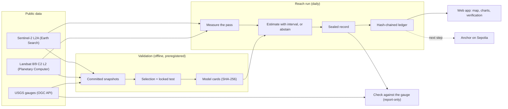

# Architecture

> **Status (2026-10-14).** This describes the system as built. The first draft (2026-10-05) proposed
> turbidity anomalies on Colombian rivers plus zero-knowledge proofs of mining-permit compliance. The
> validation rejected the Colombian estimates, and the product moved to gauged rivers
> ([D18](decisions.md), [D19](decisions.md)). The ZK compliance layer is not part of the product.

## Goals

1. **Estimate** water-quality variables from free satellite imagery, with a stated error, only where
   a gauge validated the model.
2. **Seal** every estimate, so anyone can recompute it from public data and see that it has not
   changed.
3. **Check** the estimates against the gauges as new data arrives, and report the result openly.
4. **Anchor** the ledger of seals on a public chain (the next step).

## Components

| Component             | Location                        | Role                                                                    |
| --------------------- | ------------------------------- | ----------------------------------------------------------------------- |
| Validation            | `pipeline/` (`quality`)         | Preregistered model selection and locked tests; writes the model cards  |
| Reach records         | `pipeline/` (`reach`)           | Per-pass measurement, estimates, sealed records, the ledger, the check  |
| Web app               | `web/` (Vite + React, MapLibre) | The cases, the map of each pass, charts, in-browser record verification |
| On-chain scaffold     | `contracts/` (Hardhat, circom)  | Toolchain scaffold (demo circuit, placeholder contract)                 |
| Results and contracts | `docs/`                         | Report, preregistration, record schema, decision log                    |

## Validation (`climate-pipeline quality`)

- **Snapshots:** every input (gauge values, satellite windows, Landsat temperatures) is fetched once
  into `docs/water-quality/inputs/` with a manifest. `quality run` recomputes every result from them
  offline, and `quality verify` checks the outputs byte for byte against `results/MANIFEST` in CI.
- **Protocol:** the [preregistration](water-quality/preregistration.md) fixes the candidates, the
  metrics and the levels before anything is computed.
  - Training covers hydrological years 2019–2023.
  - Selection leaves one year out at a time.
  - A locked test, 2023-12..2026-09, is scored once.
- **Model cards:** the winner fitted on the training years, its scores, its levels and its interval
  rule. A card's SHA-256 is computed over its canonical JSON.

## Reach records (`climate-pipeline reach`)

- **Geometry:** the reach's river mask, corridor and sub-reaches come from the SCL water frequency
  of a fixed period and are then frozen. The estimate station's window is the validation's.
- **Per pass:**
  - NDTI and NIR/red for each sub-reach, with their z-scores against the reach's 2019–2025 baseline.
  - The estimate at the gauge's window: turbidity in FNU from Sentinel-2, or water temperature in
    °C from Landsat (separate records).
- **Records:**
  - [observation record v2](schema/README.md) for Sentinel-2 passes, and the water-temperature
    record v1 for Landsat passes;
  - each sealed with the SHA-256 of its canonical JSON (sorted keys, no spaces, numbers as written);
  - each naming its model card's hash, its STAC items and the code commit.
- **Ledger:** an append-only JSONL file. Each line names a record's seal and the SHA-256 of the line
  before it, so changing or removing a line breaks every link after it.
- **Check:** `reach check` and `reach thermal` compare the estimates with the gauge's value at the
  overpass. They write beside the records, never inside them.
- **Isolation:** the estimate never reads a gauge value. Gauge values enter only the validation and
  the check.

## Web app (`web/`)

- **Cases:** a globe with the demo reaches. Each card is a capture of its case view.
- **Case view:**
  - a MapLibre map of the reach (3D terrain; per-pixel NDTI or true color; compare; time-lapse);
  - the case file (value, interval, level, the gauge at the overpass);
  - the record panel;
  - charts per variable, the profile along the river and the pass's statistics with the gauge's own
    readings.
- **Verification in the browser:** it recomputes a record's seal from its canonical JSON (number
  lexemes kept), walks the whole ledger and checks the model card's hash. "Alter one value first"
  shows a tampered record failing.
- **Data:** the committed examples (`docs/water-quality/reach/*/examples/`), served as static files.

## Trust model

- **A seal proves integrity, not truth.** A record that matches its seal and its ledger has not
  changed since it was sealed.
- **Correctness comes from elsewhere:**
  - the locked tests;
  - the live check, which is reported with its failures (interval coverage at Belle Chasse, the
    Platte's summer overestimate).
- **What the timing shows:**
  - the model cards are committed before the records that use them;
  - the 2026 records up to 2026-10-12 were produced in a batch, after their gauge values were
    public;
  - the strictly prospective check starts with the passes after the cards' commit.
- **Anchoring the ledger head on a public chain** would add a third-party timestamp. It can only
  prove the state from the first anchor on, never before.

## Not in the product

- **ZK proofs of permit compliance** (the first draft): an operator would prove its own readings
  meet a permit without revealing them. A proof shows the data meets the permit, not that the data
  is true. An anchored, independent satellite record is the kind of check that gap needs. The
  circuit toolchain stays in `contracts/` as a scaffold ([zk-circuits.md](zk-circuits.md)).
- **Attribution:** no output states that any actor caused anything.

## Open questions

- **Anchoring:** what to anchor (ledger heads, model-card and preregistration hashes), how often,
  and who signs (a scheduled key, or the operator's wallet from the web app).
- **Coverage:** clouds hide about three passes in four. A cloud-probability mask or more satellites
  (Landsat for turbidity) would shorten the gaps.
