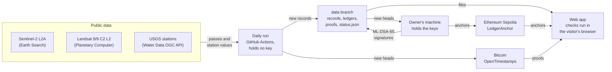
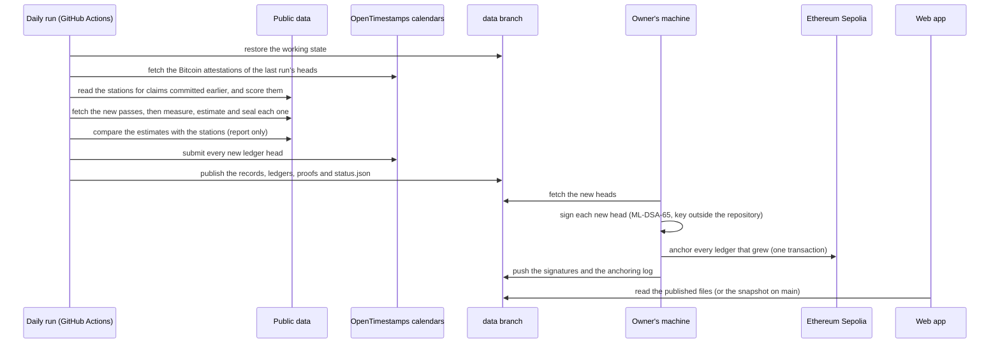
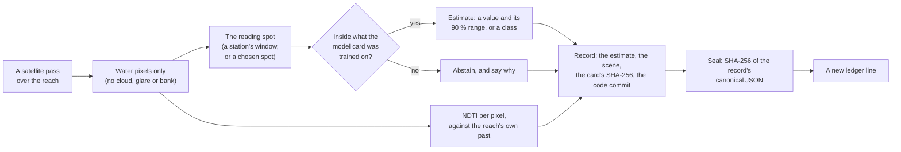
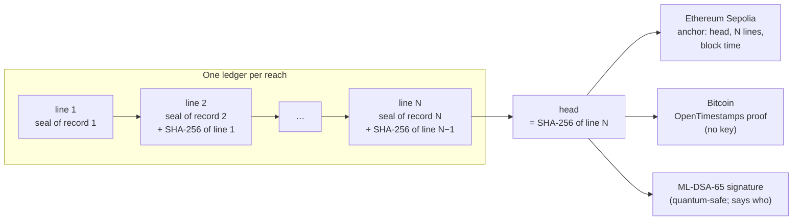
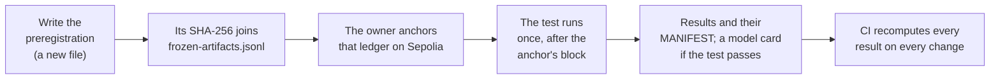
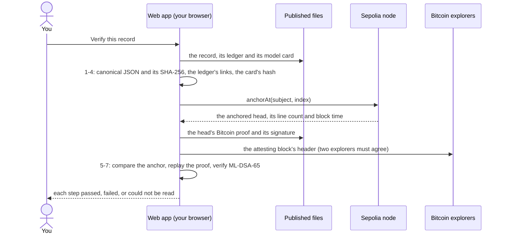

# Architecture

How RiverEtch is built, as it runs on 2026-10-21. It has four parts: a **pipeline** that turns
satellite passes into sealed records, a **web app** that shows and checks them, a **contract** on
Ethereum that dates them, and the **documents** that hold the tests and their results. The
[README](../README.md) explains what the project is for; the [trust model](trust-model.md) says
what each check proves.

## The system at a glance

Public data comes in on the left. The daily run, which holds no key, makes the records and
publishes them. The owner's machine, which holds the keys, signs and anchors them. The web app reads
the published files and the chains, and checks everything in the visitor's browser. The code, the
tests and their results live on `main`, with a snapshot of the records the app falls back to.

## The parts

| Part                  | Where                                    | What it does                                                                  |
| --------------------- | ---------------------------------------- | ----------------------------------------------------------------------------- |
| Tests and model cards | `pipeline/` (`climate-pipeline quality`) | Preregistered model selection and locked tests; writes the frozen model cards |
| Records               | `pipeline/` (`climate-pipeline reach`)   | Measures each pass, estimates, seals the record, appends it to the ledger     |
| Witnesses             | `pipeline/` (`ledger`, `sign`)           | Bitcoin timestamps of each ledger head; ML-DSA-65 signatures of each head     |
| Web app               | `web/` (Vite, React, MapLibre)           | The cases, each pass on a 3D map, the charts, and the checks in the browser   |
| Ledger anchor         | `contracts/` (Hardhat 3, Solidity)       | `LedgerAnchor`: each ledger's head, line count and block time, on Sepolia     |
| Documents             | `docs/`                                  | Preregistrations, results, records, ledgers, the trust model, the decisions   |
| Workflows             | `.github/workflows/`                     | `ci`, `quality` and `calibration` recompute and test; `daily` makes records   |

## A day in the life

The daily run starts at 13:00 and 00:00 UTC. It reads public data only and publishes to the `data`
branch. The owner then signs and anchors what it grew, from a script on their own machine
(`pipeline/scripts/anchor-pending.ps1`). Anything published after the last anchor shows as "not
anchored yet" until then.

## From a pass to a sealed record

- **Geometry.** The reach's river mask, corridor and sub-reaches come from the water frequency of a
  fixed period (Sentinel-2's scene classification) and are then frozen.
- **Per pass.** NDTI and NIR/red for each sub-reach, with their z-scores against the reach's own
  baseline; a pass whose signal is 3 or more robust spreads from the baseline is called unusual.
- **The estimate.** At the reading spot, the model card turns the pass into turbidity in FNU
  (Sentinel-2) or water temperature in °C (Landsat's thermal band, separate records). On a reach
  with no station it gives a class, never a value.
- **Along the river.** The same card's class, on a window every 600 m along the reach, frozen
  in a plan per reach (`docs/water-quality/reach/<site>/along/windows.json`). Each window is made
  exactly as a station's, and one read of the scene covers them all. The US reaches use the
  four-class transfer card; Birecik its own copy of the same model. Each pass gives an
  along-river record (`riveretch.along-river.v1`) in the reach's own ledger
  (`terrachain:<reach>:along`), witnessed like the others
  ([preregistration](water-quality/preregistration-along-river.md)). On the two reaches with a
  water-temperature card, each Landsat pass is read on the same windows' cores, on Landsat's
  30 m pixels, by that card, and each estimate becomes one of six classes (under 10 °C to 30 °C
  and over): an along-river temperature record (`riveretch.along-temperature.v1`) in the ledger
  `terrachain:<reach>:along-temperature`
  ([preregistration](water-quality/preregistration-along-temperature.md)).
- **Earlier years.** `reach archive` and `reach archive-temperature` read the years before the
  sealed records (2019 to 2025) once, with the same frozen models and code paths, along the river
  and at the station; the results are written per reach and year beside the examples, recomputed
  and never sealed ([preregistration](water-quality/preregistration-archive.md)). The app's
  calendar chooses the year. `reach archive-maps` draws each earlier pass's NDTI map and
  true-colour image with `reach render`'s code, for the `data` branch only
  ([preregistration](water-quality/preregistration-archive-maps.md)); a pass without its own is
  painted on the river's 2026 outline.
- **The reading spot.** The web app's reading spot moves to any window of the plan; away from
  the start it shows that window's classes from the along-river records, never a value. Where
  there is no estimate, the app says "No reading"; the record keeps the reason.
- **Isolation.** The estimate never reads a station value. Station values enter only the tests,
  the report-only check and the scoring, after the record is sealed.
- **The record.** An [observation record v2](schema/README.md) for each Sentinel-2 pass (a
  water-temperature record v1 for Landsat), sealed with the SHA-256 of its canonical JSON: keys
  sorted, no spaces, numbers exactly as written. Each record names its scene, its model card's hash
  and the code commit that produced it.

## Two kinds of reach

| Reach                       | A station measures turbidity? | What a record shows                                               | Its error comes from                 |
| --------------------------- | ----------------------------- | ----------------------------------------------------------------- | ------------------------------------ |
| Mississippi at Belle Chasse | yes                           | a value in FNU and its 90 % range                                 | the locked test against that station |
| Platte at Louisville        | yes                           | a value in FNU and its 90 % range                                 | the locked test against that station |
| Mississippi above Natchez   | no                            | a class (under 30, 30 to 50, 50 to 100, 100 FNU and over)         | a test on rivers the model never saw |
| Euphrates at Birecik        | no                            | a class, labelled "Outside the tested region. No error estimate." | nothing: no such test exists there   |

The app shows the class alone, for example "Under 30 FNU"; the label's facts sit behind its (?)
([preregistration-along-river.md](water-quality/preregistration-along-river.md), section 6). The
sealed records keep their labels.

The two reaches with a station are where RiverEtch measures how wrong the satellite is; the two
without one are where it is used. Each case's **Climate** tab shows the river's daily flow for
context: the station's own record; for the reach above Natchez, the record of a station upstream
(Vicksburg); for Birecik, a flood model's flow, labelled modelled.

## The ledger and its three witnesses

Each reach keeps a ledger: an append-only list where each line names a record's seal and the
SHA-256 of the line before it. Changing, removing or reordering a line breaks every link after it.
The hash of the last line (the **head**) therefore commits to every line above it, and the head is
what the three witnesses hold.

- **The anchor.** `LedgerAnchor` keeps every anchor of every ledger. Only its owner, fixed at
  deployment, can add one; nothing can edit or delete one; and a ledger's next anchor must have
  more lines than its last. Each ledger is a subject, `keccak256("terrachain:<scope>:<ledger>")`
  (the project's first name, kept so the first anchors stay valid). A record is covered by the
  first anchor with more lines than its position. The contract's source is verified on Etherscan
  and Sourcify ([anchoring](anchoring.md)).
- **The Bitcoin timestamp.** The daily run submits each new head to public OpenTimestamps
  calendars. Within hours a calendar commits it to a Bitcoin block, and the next run fetches that
  attestation into the proof (`docs/ledgers/ots/`). No key is involved.
- **The signature.** The owner signs each head, its line count, its label and the signing time with
  ML-DSA-65 (FIPS 204). The public key is frozen in the frozen-artifacts ledger. A signature says
  who published a head; the time comes from the two chains.

## How a test is run only once

A test is fair only if its rules were fixed before its answer was known. Every test follows the
same path, and anything decided after seeing a result is labelled so.

- **Inputs.** Every input (station values, satellite windows, Landsat temperatures) is fetched once
  into `docs/water-quality/inputs/` with a manifest, so `quality run` can recompute every result
  offline.
- **Protocol.** The [preregistration](water-quality/preregistration.md) fixes the candidates, the
  metrics and the levels. Training covers the hydrological years 2019 to 2023, selection leaves one
  year out at a time, and a locked test, December 2023 to September 2026, is scored once.
- **Checks.** `quality verify`, `quality transfer-verify` and `quality class-verify` compare every
  output with its MANIFEST in CI, byte for byte or to the last printed digit. `ledger verify`
  checks that no frozen file changed.
- **Scoring.** The scoring rule ([v1](water-quality/prospective.md),
  [v2](water-quality/prospective-v2.md)) is frozen the same way. A new pass counts as prospective
  only if its record was committed (anchored on Sepolia, or timestamped on Bitcoin plus two hours)
  before RiverEtch read the station. Each outcome goes to an outcomes ledger, which is anchored too.

## Checking a record

**Verify this record** runs entirely in the visitor's browser. It trusts no server of RiverEtch's:
it reads public files and public chains, and recomputes every hash itself.

- **Published files** are read from the `data` branch, or from the snapshot on `main` when the
  `data` branch cannot be read.
- **The Sepolia node** is a public one, or the visitor's own wallet connection if they connect one.
- **The Bitcoin explorers** are mempool.space and blockstream.info. Anyone can check the same proof
  with their own node or with `ots verify`.
- **Change one number first** alters one value in memory before the check, to show the seal and
  the ledger failing. **Check a file you were sent** compares a record (JSON) or a series (CSV)
  with the sealed records and names any value that changed.

## Where the data lives

| Where                                          | What                                                                                        |
| ---------------------------------------------- | ------------------------------------------------------------------------------------------- |
| `data` branch                                  | The records, ledgers, proofs and `status.json` the daily run publishes: the source of truth |
| `main`, `docs/water-quality/reach/*/examples/` | A snapshot of those files, which the web app reads when `data` cannot be read               |
| `docs/ledgers/`                                | The frozen-artifacts ledger, the anchoring log (rebuilt from the chain), proofs, signatures |
| `docs/water-quality/results/`                  | Every result and model card, with their MANIFESTs                                           |
| Sepolia, `0xe5d12E7C…e762`                     | Every anchor ever made, readable by anyone                                                  |

## Not in the product

- **Zero-knowledge proofs of permit compliance** (the first draft): an operator would prove its own
  readings meet a permit without revealing them. A proof shows the data meets the permit, not that
  the data is true, and an anchored, independent satellite record is the kind of check that gap
  needs. The scaffold was removed ([D24](decisions.md)); it stays in the git history.
- **Attribution:** no output says any event was caused by anything or anyone.
- **Forecasts:** every reading is of a pass that already happened.

## Open questions

- **Anchoring needs a person.** The owner anchors with a script on their own machine. A scheduled
  anchor would need a funded key inside the scheduled job, which this design avoids; the Bitcoin
  timestamps already date every head with no key.
- **Clouds** hide about three passes in four. More satellites (Landsat for turbidity) or a
  cloud-probability mask would shorten the gaps.
- **Long ledgers.** Each ledger is replayed in full. A Merkle tree would allow proofs of single
  lines once the ledgers grow long.
